<div dir="rtl" align="right">

# ✦ אטלייה: מערכת חכמה לסטודיו לאדריכלות ועיצוב פנים

מערכת Full Stack שמנהלת את כל מחזור החיים של סטודיו לאדריכלות. התהליך מתחיל מהפנייה הראשונה באתר ומשם עובר דרך צנרת המכירות, הצעת המחיר והחתימה. בהמשך המערכת מלווה את ניהול הפרויקט, התקציב, היומן והגבייה, ומספקת ללקוח פורטל אישי. בנוסף יש בה כלי עיצוב: מתכנן חדרים, חילוץ פלטת צבעים ומחשבון חומרים.

פותח בשיתוף עם חוי בליזינסקי.

### 🔗 [לצפייה בהדגמה החיה](https://chaya808080.github.io/architect-studio/)

ההדגמה רצה במלואה בדפדפן עם נתונים בדויים, ואין צורך להתקין שום דבר. כל הכללים העסקיים פועלים בה בדיוק כמו בשרת.

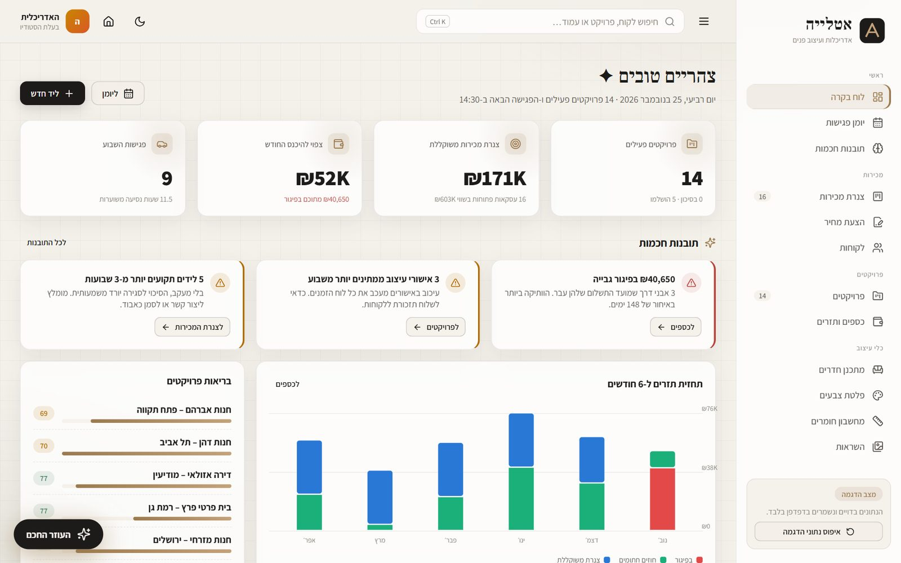

---

## שלושה ממשקים במערכת אחת

| ממשק | למי | מה יש בו |
|---|---|---|
| **אתר הסטודיו** | לקוחות חדשים | תיק עבודות, סליידר לפני/אחרי, שאלון סגנון, מחשבון עלויות וקביעת פגישה לפי זמינות אמיתית |
| **הסטודיו** | האדריכלית | לוח בקרה, צנרת מכירות, הצעות מחיר, פרויקטים, יומן, כספים, תובנות וכלי עיצוב |
| **פורטל לקוח** | לקוחות פעילים | התקדמות הפרויקט, אישור גרסאות עיצוב או בקשת שינויים, תשלומים, הפגישה הבאה |

כל פעולה בממשק אחד מופיעה מיד בממשקים האחרים. למשל, כשלקוח קובע פגישה באתר, נוצרים אוטומטית לקוח, ליד בצנרת ופגישה ביומן.

---

## ✨ פיצ'רים חכמים

| פיצ'ר | מה הוא עושה | איך זה עובד |
|---|---|---|
| **הצעת מועדים חכמה** | מציע מועדים לפגישה ומונע קביעה בלתי אפשרית | בודק שעות עבודה וחפיפות, וגם **זמן נסיעה בין ערים** (מרחק לפי נוסחת Haversine, עם מקדם כבישים וזמן חניה). מעדיף ימים שבהם האדריכלית כבר נמצאת באותו אזור |
| **ציון לידים** | מדרג לידים 0–100 (חם / פושר / קר) ומפרט את הסיבות | מודל משוקלל: תקציב למ״ר, גודל וסוג הנכס, מקור הפנייה, פגישה שהתקיימה וזמן ללא התקדמות |
| **בריאות פרויקט** | ציון 0–100 לכל פרויקט, עם רשימת בעיות | משימות באיחור, פער בין ההתקדמות לזמן שחלף, חריגות תקציב לפי קטגוריה, תשלומים בפיגור ומועד יעד שעבר |
| **תחזית תזרים** | הכנסות צפויות ל-6 חודשים | אבני דרך שטרם שולמו מחוזים חתומים, ועליהן צנרת המכירות משוקללת בהסתברות לכל שלב |
| **מנוע תמחור** | הצעת מחיר אוטומטית והערכת תקציב שיפוץ | שכר טרחה למ״ר לפי סוג נכס, עם הנחת כמות מעל 120 מ״ר ומקדם להיקף השירות. התקציב מחושב לפי קטגוריות ורמת גימור, כולל מע״מ ולוח תשלומים |
| **מתכנן חדרים** | גרירת רהיטים על תוכנית קומה | הצמדה לרשת, זיהוי חפיפות וחריגה מהקירות, בדיקת **מעברים צרים מ-60 ס״מ**, אחוז תפוסה, **סידור אוטומטי** לפי כללי עיצוב וייצוא ל-PNG |
| **פלטת צבעים מתמונה** | מעלים תמונה ומקבלים את הצבעים הדומיננטיים | **k-means** על פיקסלים, שמות צבעים בעברית, חלוקת 60-30-10, הרמוניות (משלים, אנלוגי, טריאדי) ובדיקת ניגודיות לפי WCAG |
| **מחשבון חומרים** | כמויות צבע, ריצוף ואריחים | שטחי קירות נטו, 2 שכבות צבע, פחת של 10%/15% והמרה לקרטונים |
| **שאלון סגנון** | פרופיל עיצובי ללקוח | כל תשובה מוסיפה משקלות לסגנונות, והתוצאה מנורמלת לאחוזים וכוללת פלטה והשראות |
| **עוזר חכם בעברית** | שאלות חופשיות, גם בקול | זיהוי כוונה וישויות: שמות לקוחות, ערים ומספרים כמו "120 מ״ר". למשל: "כמה תעלה דירה של 120 מ״ר?", "מתי אפשר לקבוע פגישה בהרצליה?" |
| **תובנות אוטומטיות** | כרטיסי תובנה עם פעולה מוצעת | פיגורי גבייה, פרויקטים בסיכון, אישורים תקועים, לידים חמים ותקועים, שעות נסיעה צפויות ושלב הנשירה הגדול במשפך |

<p align="center"><b>צנרת מכירות עם ציון לידים</b></p>

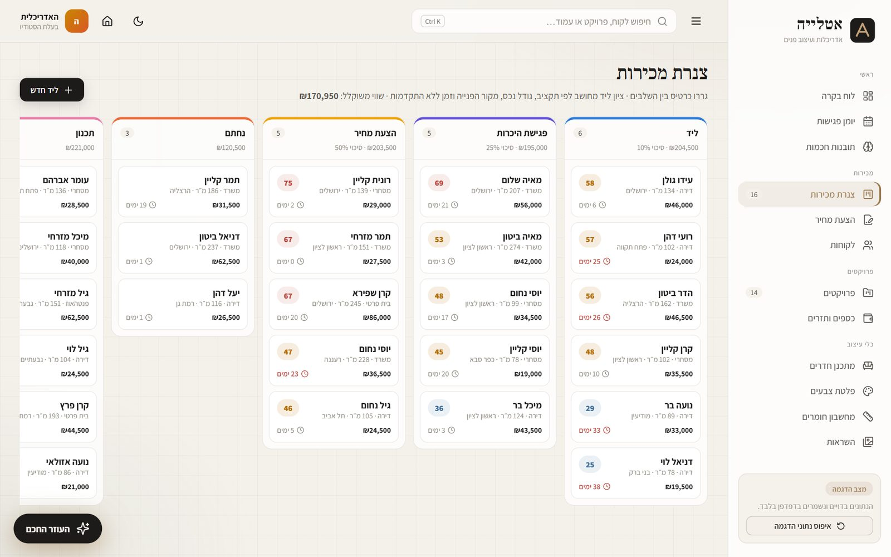

<p align="center"><b>סביבת עבודה לפרויקט: גאנט, בריאות ופלטה</b></p>

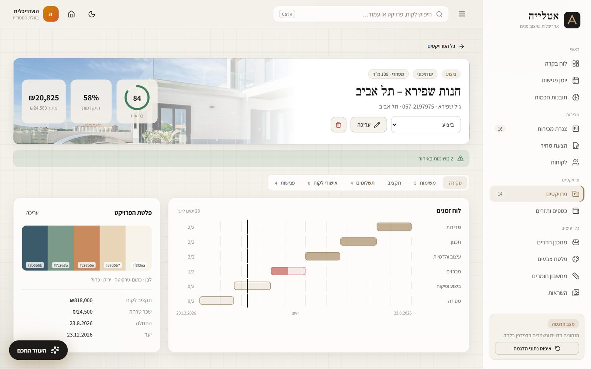

<p align="center"><b>יומן עם זמני נסיעה, והצעת מועדים חכמה</b></p>

| | |
|---|---|
| 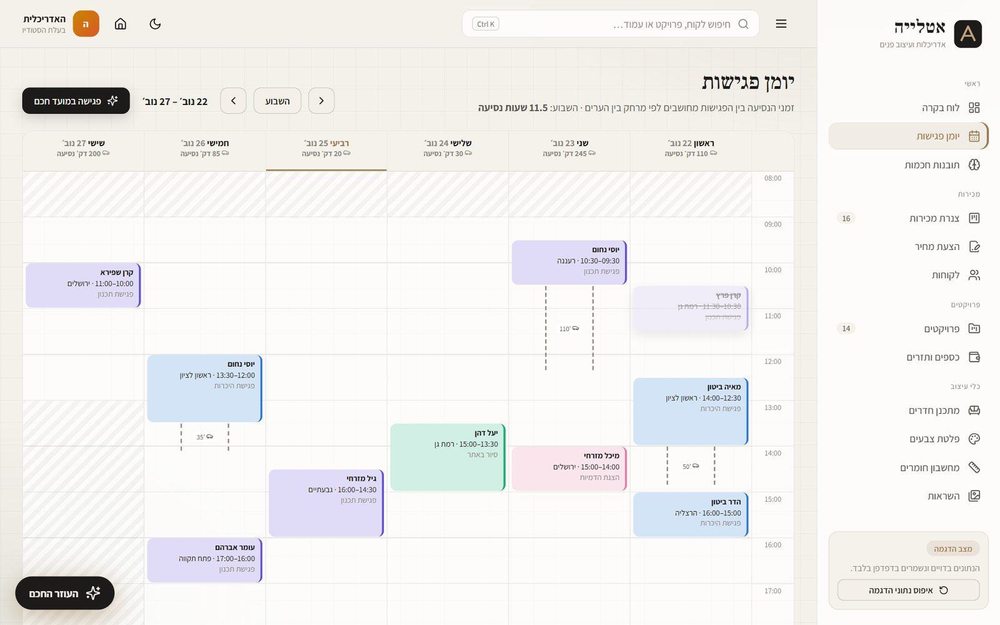 | 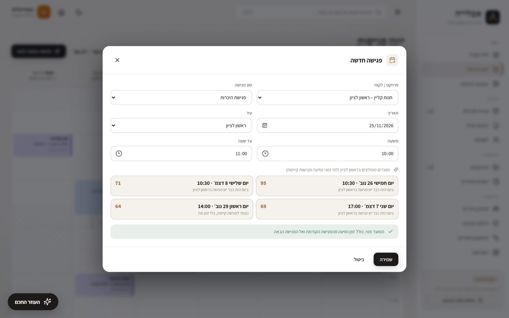 |
| 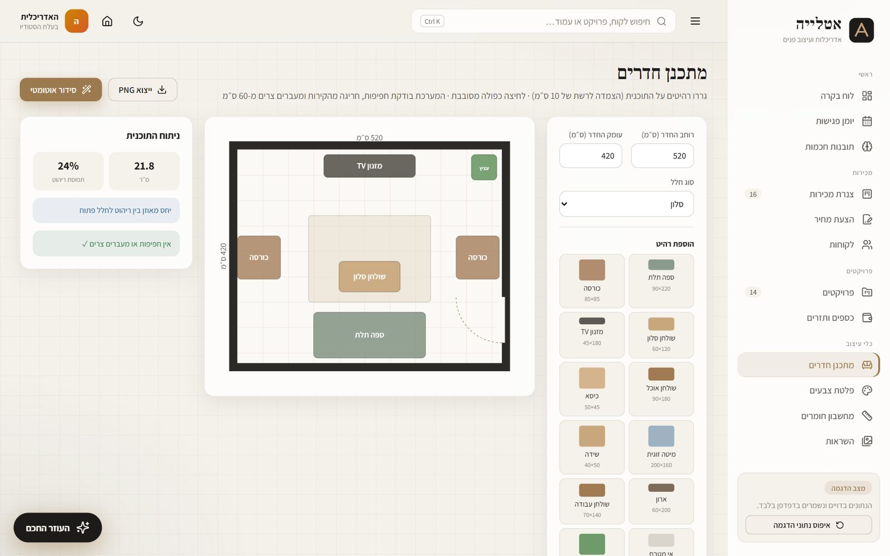 | 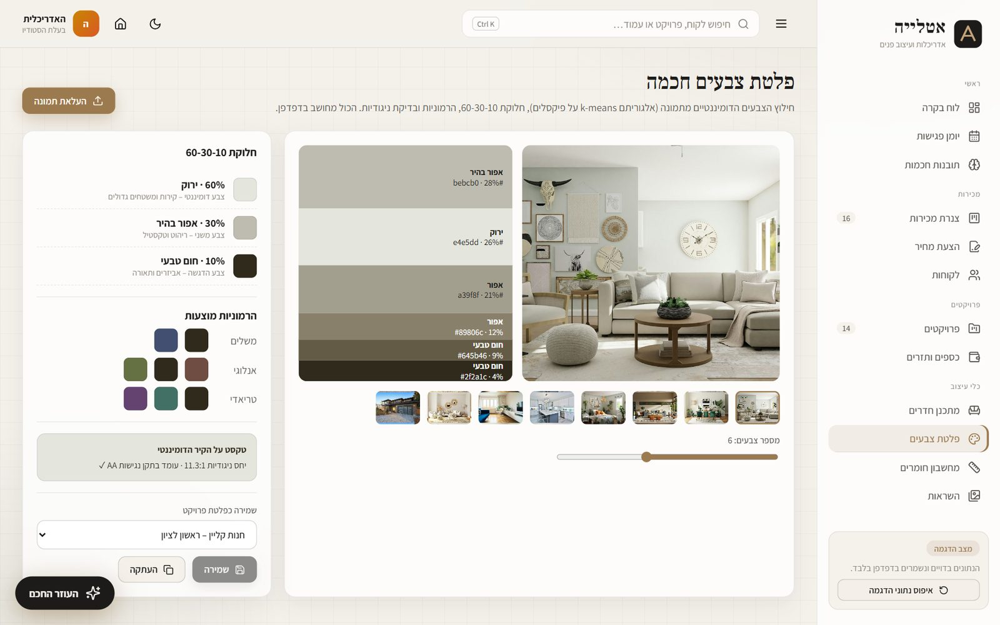 |
| 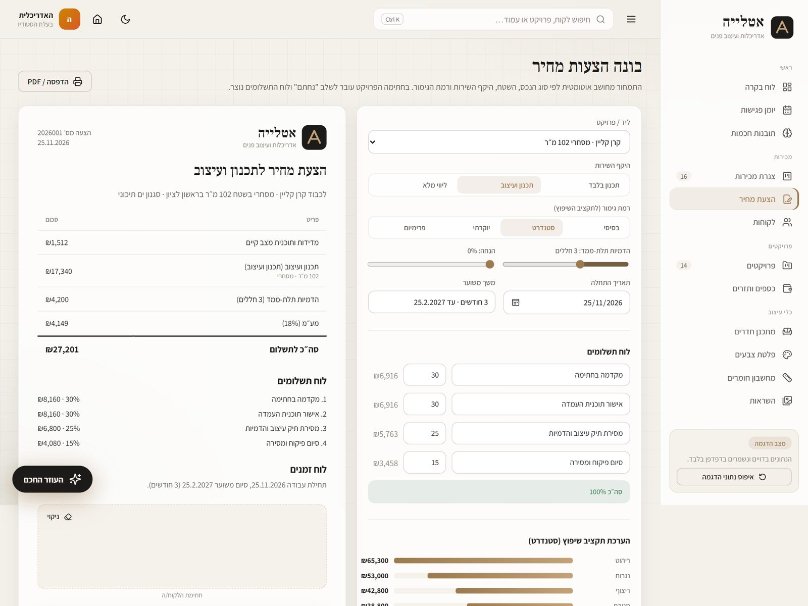 | 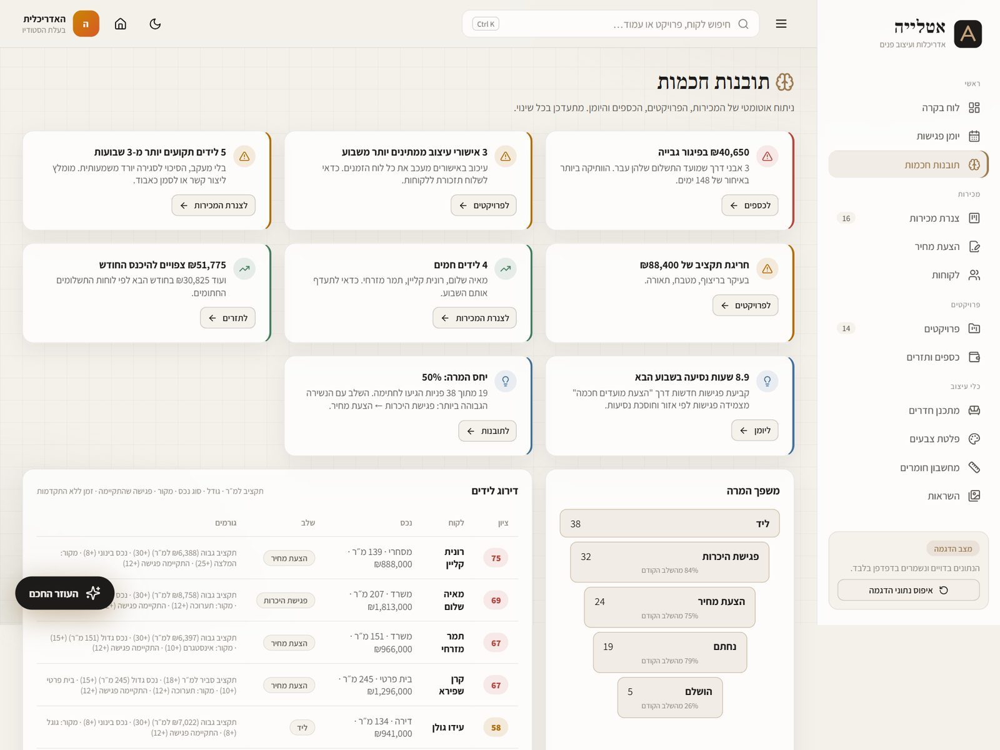 |
| 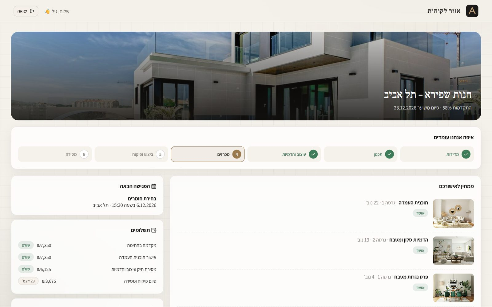 | 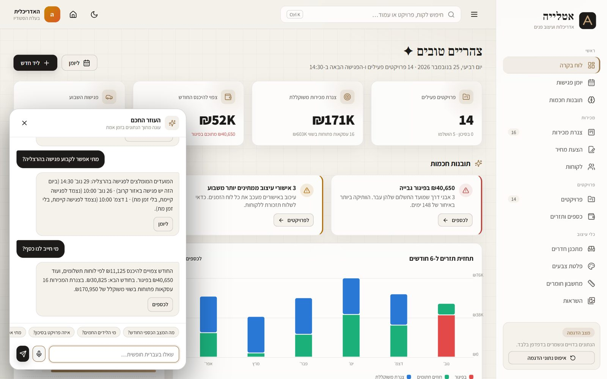 |
| 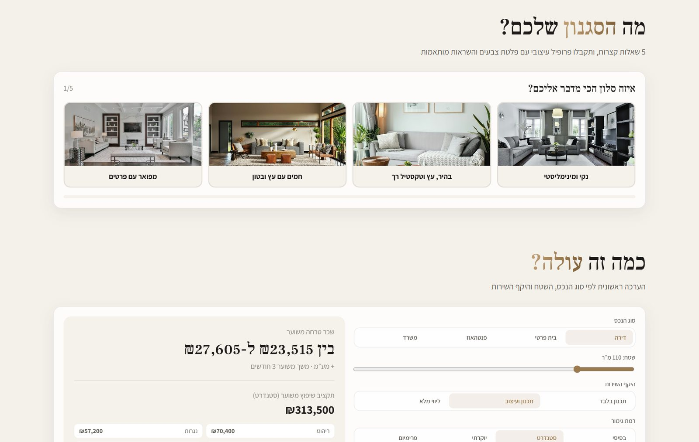 | 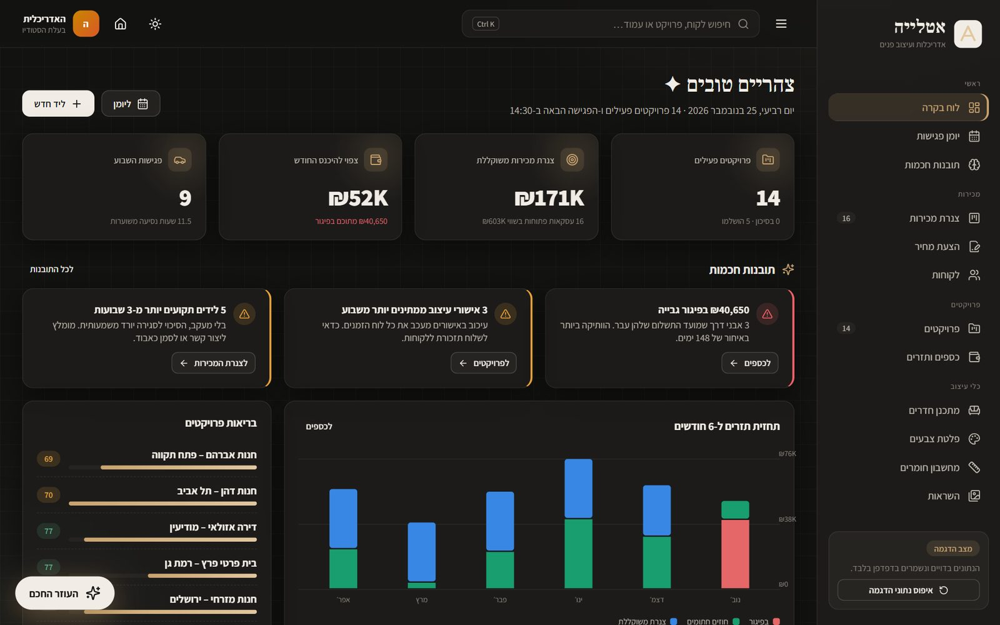 |

---

## 🏗️ ארכיטקטורה

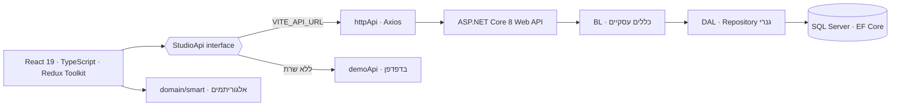

**צד שרת** ([`server`](server)), ‏.NET 8:
- **שכבות API, BL ו-DAL.** כל בקשה מקבלת Unit of Work משלה (DbContext ב-Scoped).
- **EF Core, Code-First:** 9 טבלאות עם מפתחות זרים, מחיקה מדורגת (cascade) של משימות, תקציב, תשלומים ואישורים, אינדקסים ו-Value Converter לפלטת הצבעים.
- **Repository גנרי אחד** משרת את כל הטבלאות.
- **כללים עסקיים זהים לאלה של הלקוח:**
  - חפיפת פגישות וזמני נסיעה.
  - מעבר בין שלבים: אי אפשר להתקדם לתכנון בלי לוח תשלומים של 100%.
  - אבני דרך שלא עוברות 100%.
  - מניעת מחיקת לקוח שיש לו פרויקטים.
- **חתימה על הצעה בטרנזקציה אחת:** עדכון שכר הטרחה והתאריכים, מעבר לשלב "נחתם" ויצירת לוח התשלומים.
- **ProblemDetails עם הודעות בעברית, Swagger ו-CORS מקובץ ההגדרות.** סקריפט יצירת המסד נמצא ב-[`database/schema.sql`](server/database/schema.sql).

**צד לקוח** ([`client`](client)), ‏React 19, TypeScript ו-Vite:
- **ממשק API אחד ושני מימושים:** שרת אמיתי, או הדגמה בדפדפן עם אותם כללים, כולל rollback כשפעולה נכשלת.
- **שכבת דומיין טהורה** ([`src/domain`](client/src/domain)), נפרדת מהממשק ומכוסה בבדיקות.
- **ממשק:** Code splitting לכל מסך, מצב כהה ובהיר, מימין לשמאל, מותאם למובייל, חיפוש מהיר (Ctrl+K) והדפסת הצעות מחיר ל-PDF.

---

## ✅ בדיקות ו-CI/CD

- **שרת:** 27 בדיקות xUnit:
  - כללים עסקיים, וגם בדיקה שזמני הנסיעה בשרת **זהים בדיוק** לאלה של הלקוח.
  - חתימה בטרנזקציה, מחיקה מדורגת ושמירת הפלטה.
  - בדיקות אינטגרציה על צינור ASP.NET Core המלא.
- **לקוח:** 23 בדיקות Vitest:
  - כל נתוני ההדגמה עומדים בכללים העסקיים.
  - כל מועד שהמערכת מציעה פנוי באמת.
  - הסידור האוטומטי לא יוצר חפיפות.
  - k-means מוצא את הצבעים הנכונים.
  - המשפך יורד באופן מונוטוני.
- **GitHub Actions:** בכל שינוי רצים build ובדיקות לשרת וללקוח. רק אם הכול עובר, ההדגמה החיה מתפרסמת ל-GitHub Pages.

---

## 🚀 הרצה מקומית

```bash
# לקוח (מצב הדגמה)
cd client && npm install && npm run dev

# שרת (‎.NET 8 + SQL Server LocalDB) – יוצר מסד ונתוני הדגמה בהרצה הראשונה
cd server && dotnet run --project API          # https://localhost:7110/swagger
dotnet test ArchitectStudio.sln

# לקוח מחובר לשרת
cd client && VITE_API_URL=https://localhost:7110/api npm run dev
```

📖 הסבר מפורט על האלגוריתמים: [`docs/HOW-IT-WORKS.md`](docs/HOW-IT-WORKS.md) · קרדיט לתמונות: [`client/public/img/CREDITS.md`](client/public/img/CREDITS.md)

</div>
