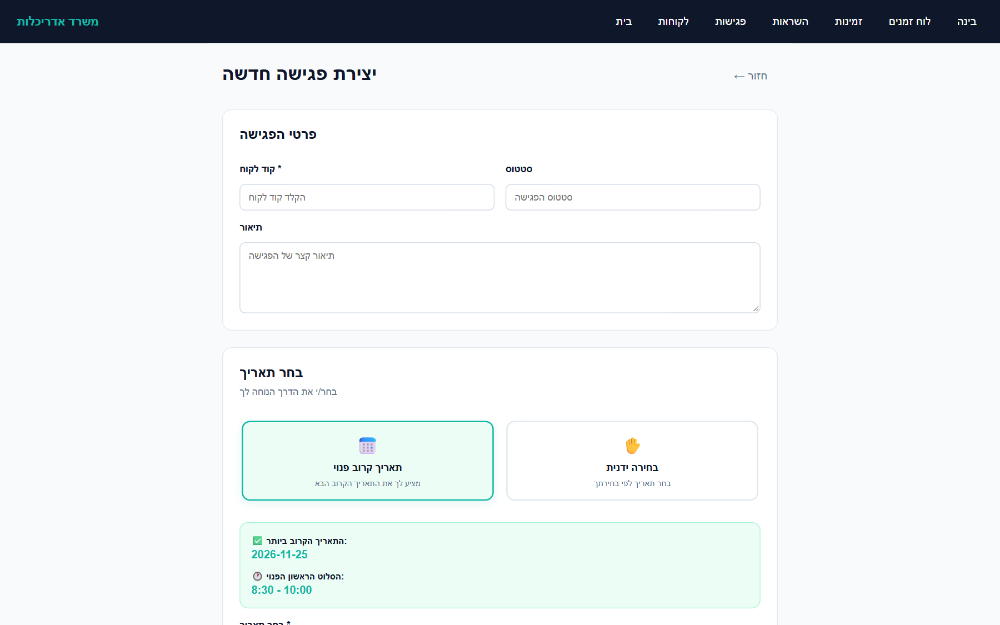
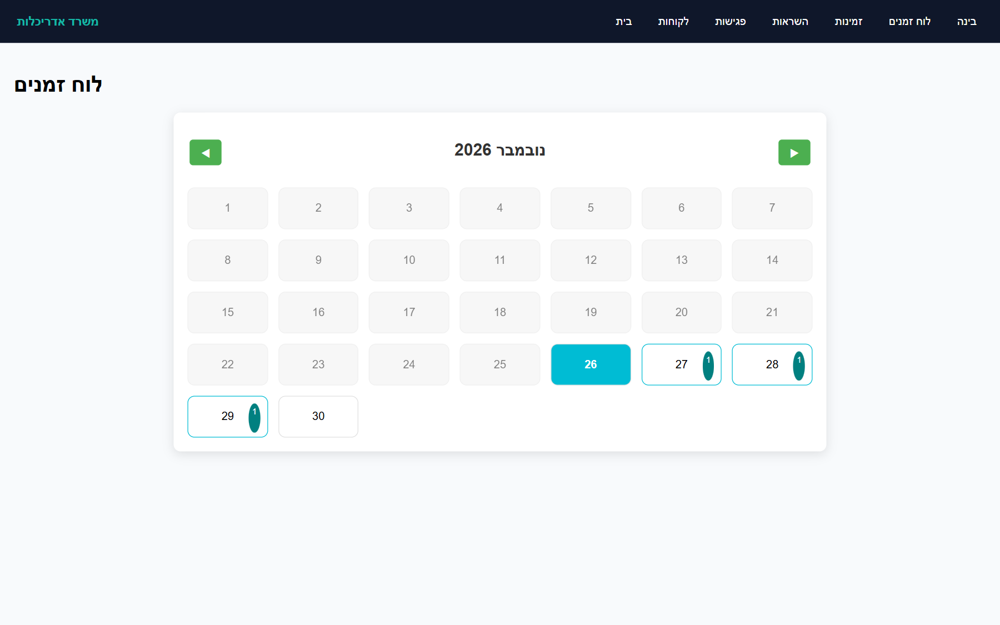
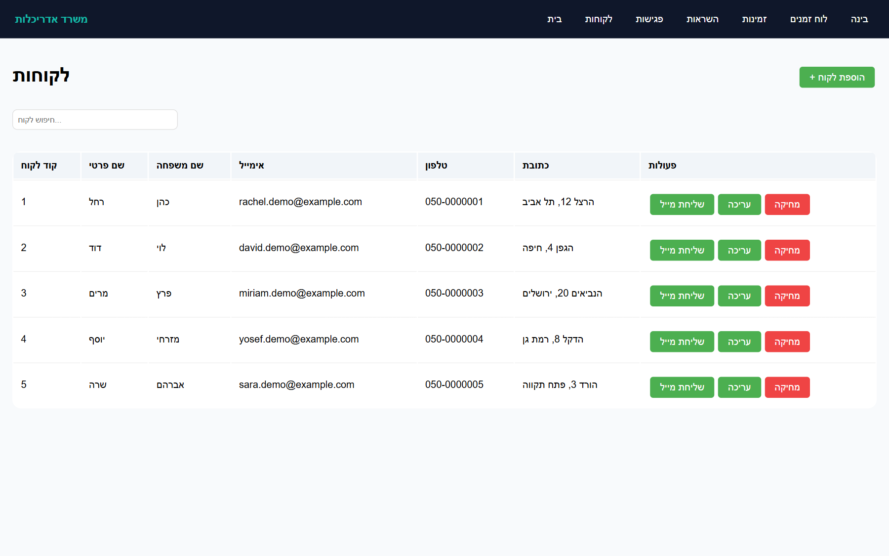
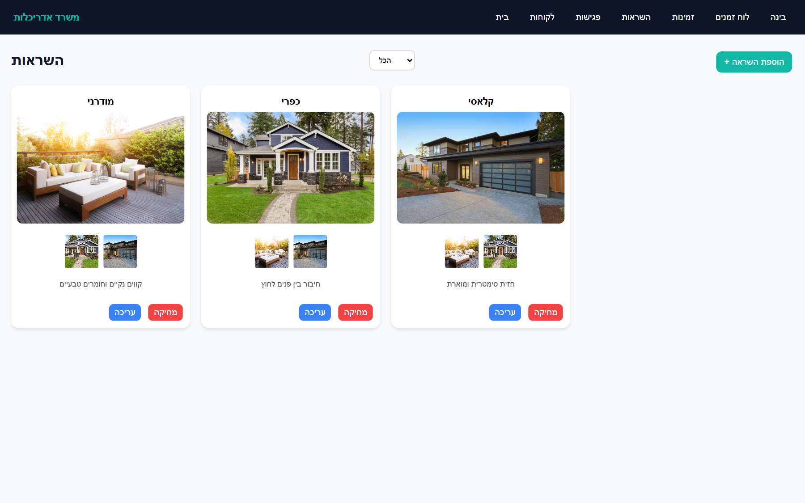
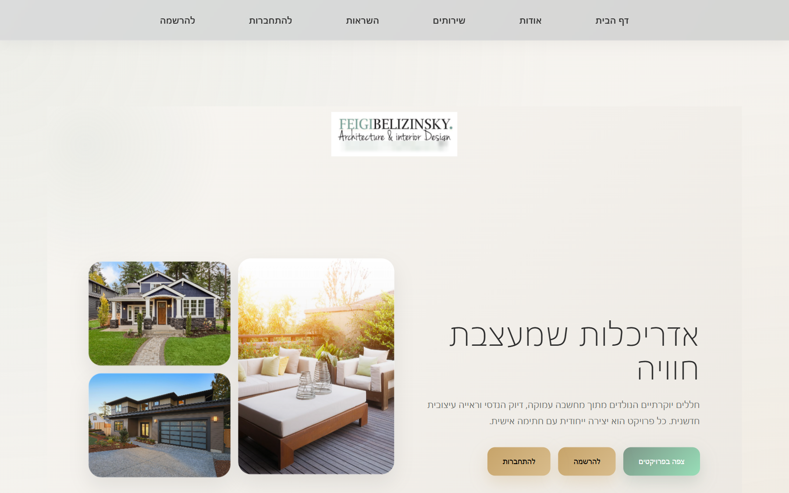
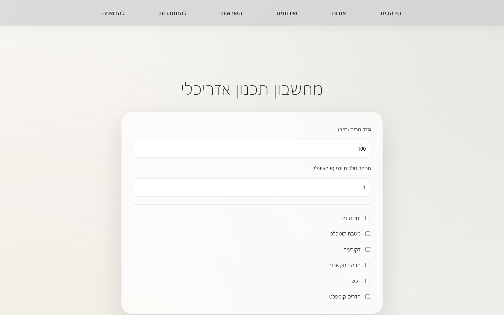

<div dir="rtl" align="right">

# מערכת לניהול סטודיו לאדריכלות ועיצוב פנים

מערכת Full Stack לסטודיו לאדריכלות. היא מחברת בין אתר ללקוחות, ממשק ניהול לאדריכלית ושרת Web API עם מסד נתונים.

פותח בשיתוף עם חוי בליזינסקי.

**טכנולוגיות:** React · Redux Toolkit · ASP.NET Core 8 · Entity Framework Core · SQL Server · n8n · OpenAI

---

## מבנה המערכת

| חלק | תיקייה | תפקיד |
|---|---|---|
| ממשק ניהול | [`admin-client`](admin-client) | ניהול לקוחות, פגישות, יומן, שעות עבודה וגלריית השראות |
| אתר לקוחות | [`customer-client`](customer-client) | אתר תדמית, גלריה, מחשבון עלויות, קביעת פגישה, הרשמה וחתימה על הסכם |
| שרת | [`server`](server) | ASP.NET Core Web API בארכיטקטורת שכבות (N-Tier) |

```
React (Admin / Customer)  ──Axios──▶  ASP.NET Core Web API  ──▶  BL  ──▶  DAL (EF Core)  ──▶  SQL Server
```

---

## צד שרת: ASP.NET Core 8

- **ארכיטקטורת שכבות:** ‏API (Controllers), ‏BL (לוגיקה עסקית ו-DTOs) ו-DAL (גישה לנתונים). כל שכבה חשופה דרך ממשקים (Interfaces) בלבד.
- **Dependency Injection:** כל השירותים נרשמים ונבנים דרך `ServiceCollection`.
- **Entity Framework Core מול SQL Server:** מודל Database-First עם קשרים (Foreign Keys), ערכי ברירת מחדל וטיפוסים מדויקים, כמו `decimal(10,2)` לסכומים.
- **Async/Await לכל אורך הדרך:** מה-Controller ועד `SaveChangesAsync`.
- **REST API מלא (CRUD)** ללקוחות, פגישות, השראות ושעות עבודה שבועיות.
- **העלאת קבצים:** תמונות נשמרות ב-`wwwroot/Images` עם שם ייחודי. בעדכון או במחיקה של השראה נמחקות גם התמונות הישנות מהדיסק.
- **שליחת מיילים** ללקוחות דרך SMTP.
- **Swagger** לתיעוד ולבדיקת ה-API, ו-**CORS Policy** שמתירה גישה רק לשני הקליינטים.

## ממשק ניהול: React

- **מנוע זמינות לקביעת פגישות** ([`availabilityEngine.js`](admin-client/src/features/scheduler/availabilityEngine.js)):
  - מחלק את שעות העבודה השבועיות של האדריכלית לחלונות של 90 דקות.
  - מזהה התנגשויות עם פגישות קיימות.
  - מחפש את התאריך הפנוי הקרוב ביותר בטווח של 30 יום.
- **יומן חודשי:** כל יום מסומן לפי פגישות ושעות פנויות.
- **ניהול לקוחות:** הוספה, עריכה, מחיקה, חיפוש, מעקב תשלומים ויתרה, מעקב פגישות שנותרו ושליחת מייל ללקוח.
- **ניהול גלריית השראות:** העלאת תמונה ראשית ותמונות חדרים.
- **עוזר AI:** צ'אט מבוסס תהליך n8n שמחובר ל-OpenAI.
- **ניהול State:** בעזרת Redux Toolkit (`createSlice`, `createAsyncThunk`) ושכבת Services נפרדת לקריאות API.

## אתר לקוחות: React

- **דף נחיתה, אודות, שירותים** וגלריית השראות אינטראקטיבית.
- **מחשבון עלויות לפרויקט:** הערכת מחיר ומשך עבודה לפי סוג הנכס, גודל, רמת גימור וסוג שירות.
- **קביעת פגישת ייעוץ.**
- **הרשמה עם ולידציה בצד הלקוח**, וזיהוי לקוח קיים לפי כתובת המייל.
- **חתימה דיגיטלית על הסכם:** חתימה על Canvas (`react-signature-canvas`) והפקת PDF חתום עם jsPDF.
- **אנימציות** עם Framer Motion ועיצוב עם SCSS (משתנים ו-Mixins).

---

## צילומי מסך (נתוני הדגמה)

> כל השמות והפרטים בצילומים בדויים.

<p align="center"><b>ממשק ניהול: קביעת פגישה עם חישוב חלונות זמן פנויים</b></p>



<p align="center"><b>ממשק ניהול: יומן</b></p>



<p align="center"><b>ממשק ניהול: לקוחות</b></p>



<p align="center"><b>ממשק ניהול: גלריית השראות</b></p>



<p align="center"><b>אתר לקוחות: דף הבית</b></p>



<p align="center"><b>אתר לקוחות: מחשבון עלויות</b></p>



---

## הרצה מקומית

**שרת** (דורש .NET 8 SDK ו-SQL Server LocalDB):
```bash
cd server
dotnet run --project API_1        # https://localhost:7110/swagger
```
את מחרוזת החיבור למסד הנתונים מגדירים ב-`server/DAL/Models/DbManager.cs`.

**ממשק ניהול / אתר לקוחות:**
```bash
cd admin-client        # או customer-client
npm install
npm start
```
כדי להפעיל את עוזר ה-AI, מגדירים בקובץ `admin-client/.env` את הכתובת `REACT_APP_N8N_CHAT_URL`.

</div>
